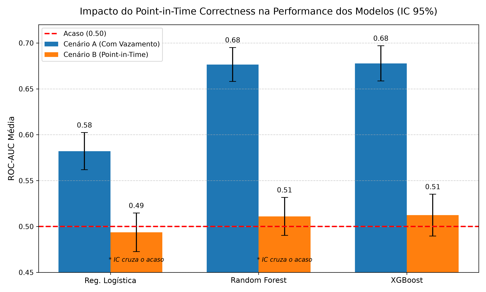
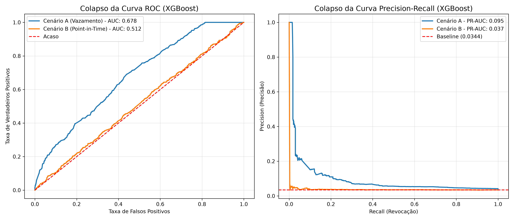

# tcc-1
Arquitetura Lakehouse com Feature Store para Sustentação de Pipelines de MLOps

**Orquestração MLOps e Análise de Point-in-Time Correctness**

Este repositório contém o código-fonte do Trabalho de Conclusão de Curso em Engenharia de Computação, focado na implementação de uma arquitetura baseada no *Modern Data Stack*. O objetivo prático é evidenciar o impacto analítico e preditivo do vazamento de dados (*data leakage*) versus a modelagem temporal correta (*point-in-time correctness*) em bases de dados.

## Visão Geral do Projeto

O projeto automatiza e compara o desempenho de modelos preditivos em dois cenários distintos de preparação de dados:

* **Cenário A (Com Vazamento Temporal):** O dataset ignora a evolução temporal das *features*, resultando em um modelo com métricas ilusoriamente infladas.
* **Cenário B (Point-in-Time):** Aplicação de rigorosa consistência temporal na extração das características, refletindo a verdadeira capacidade de generalização do modelo em produção.

## Arquitetura e Tecnologias

A solução integra ferramentas de padrão corporativo, isolando a infraestrutura de dados da camada de ciência de dados:

* **Armazenamento e Processamento:** Snowflake, utilizando governança de acesso via Autenticação por Par de Chaves RSA (slots independentes para ferramentas).
* **Transformação (ELT):** dbt (*Data Build Tool*) responsável pela materialização das tabelas *Gold*.
* **Orquestração MLOps:** Apache Airflow 2.10.2 operando como maestro de dependências lógicas.
* **Machine Learning:** Python (XGBoost, scikit-learn) com foco em métricas adequadas para classes altamente desbalanceadas (PR-AUC, IC 95% via Bootstrap).

## Estrutura do Pipeline

A automação (*DAG*) no Airflow garante que o modelo só seja reavaliado mediante a atualização prévia da base de dados.

* `executar_modelos_dbt`: Aciona o motor do dbt para compilar e reconstruir as visões no Snowflake.
* `treinar_modelo_xgboost`: Extrai de forma segura as tabelas processadas, realiza o balanceamento de pesos de forma dinâmica, treina os classificadores e consolida as métricas finais (ROC-AUC, Precision-Recall e Matrizes de Confusão).

## Como Reproduzir o Ambiente

Para executar o pipeline localmente, configure previamente o seu arquivo `.env` com as credenciais do Snowflake e cadastre sua chave pública (`.pub`) no *Data Warehouse*.

* Ative o ambiente virtual isolado: `source venv_tcc/bin/activate`
* Aponte o diretório de orquestração: `export AIRFLOW_HOME=~/github/tcc-1/airflow-tcc/`
* Inicie o servidor da interface web: `airflow webserver --port 8080`
* Em um terminal secundário, inicie o motor de agendamento: `airflow scheduler`
* Acesse o painel web local, ative a DAG `pipeline_tcc_dbt_xgboost` e clique em *Trigger DAG*.

## Resultados Analíticos: A Prova do Colapso

Os gráficos abaixo materializam a conclusão central deste projeto, ilustrando a drástica queda de desempenho preditivo quando a fuga de informação temporal (*data leakage*) é corrigida no conjunto de dados.

### 1. Comparação de Performance (ROC-AUC Médio com IC 95%)
No Cenário A, os modelos apresentam métricas preditivas artificialmente elevadas devido ao acesso a dados do futuro. No Cenário B, com a modelação *Point-in-Time* correta, as barras de erro da Regressão Logística e do Random Forest cruzam diretamente a linha do acaso (0.50).

### 2. Colapso das Curvas ROC e PR-AUC (XGBoost)
A verdadeira magnitude do impacto revela-se no desempenho do algoritmo XGBoost perante as classes desbalanceadas. Na curva *Precision-Recall* (à direita), a métrica do Cenário B desce de forma abrupta e acompanha a linha de base aleatória (0.0522), demonstrando matematicamente que o modelo não consegue generalizar e distinguir os verdadeiros atrasos em ambiente de produção.

Basta interromper os processos diretamente no terminal usando `Ctrl + C`. Como você está rodando o Airflow localmente para desenvolvimento e não há nenhuma DAG em execução neste exato momento, essa é a forma padrão e totalmente segura de desligar os serviços.

**Como desligar agora:**

1. Vá até a aba do terminal onde o **Scheduler** (motor) está rodando e pressione `Ctrl + C`. Aguarde ele encerrar o processo.
2. Vá até a aba do terminal onde o **Webserver** (interface da porta 8080) está rodando e pressione `Ctrl + C`.
3. Digite `deactivate` em ambas as abas para fechar o seu ambiente virtual (`venv_tcc`) de forma limpa. Pode fechar os terminais em seguida.

**Como religar amanhã:**
Quando for retomar o projeto, lembre-se de que é necessário reativar o ambiente e exportar a variável de diretório em cada aba nova antes de subir os serviços, exatamente como fizemos hoje:

1. `source ~/github/tcc-1/venv_tcc/bin/activate`
2. `export AIRFLOW_HOME=~/github/tcc-1/airflow-tcc/`
3. Inicie o `airflow webserver --port 8080` (aba 1) e o `airflow scheduler` (aba 2).