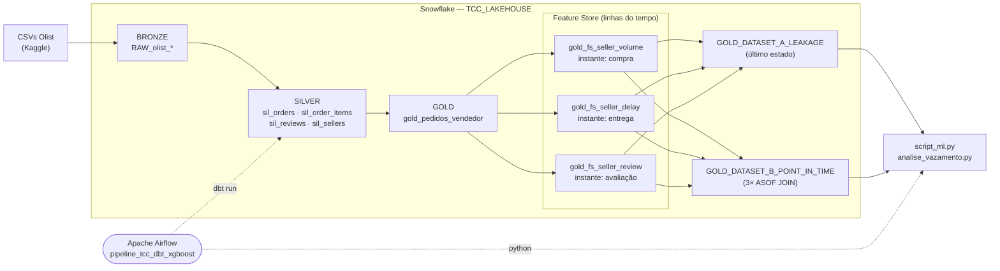
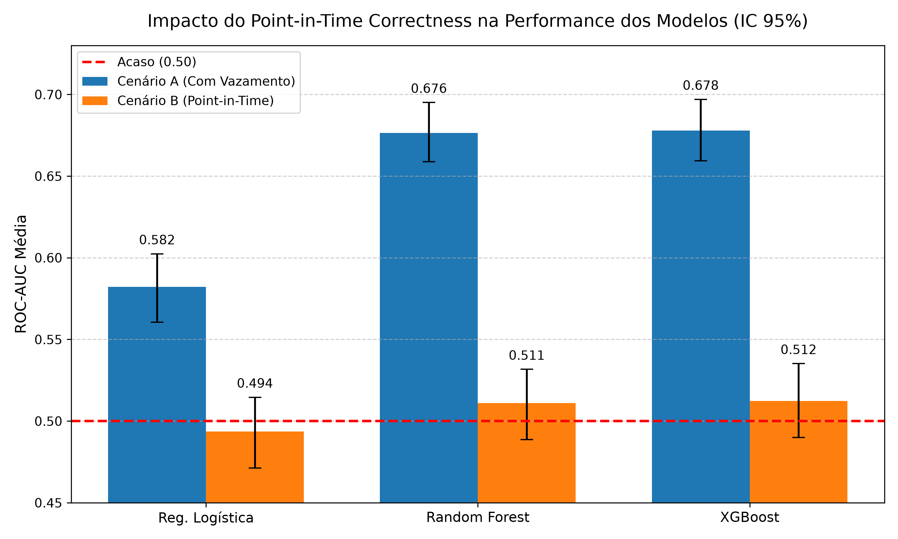
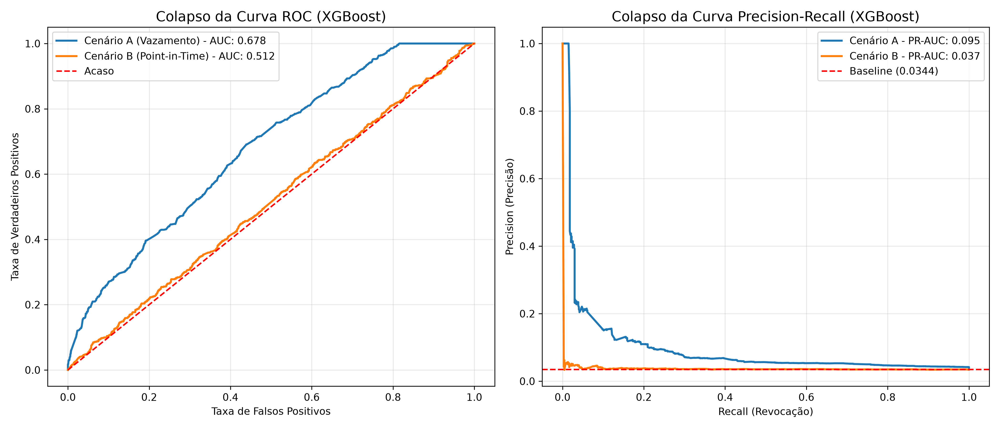
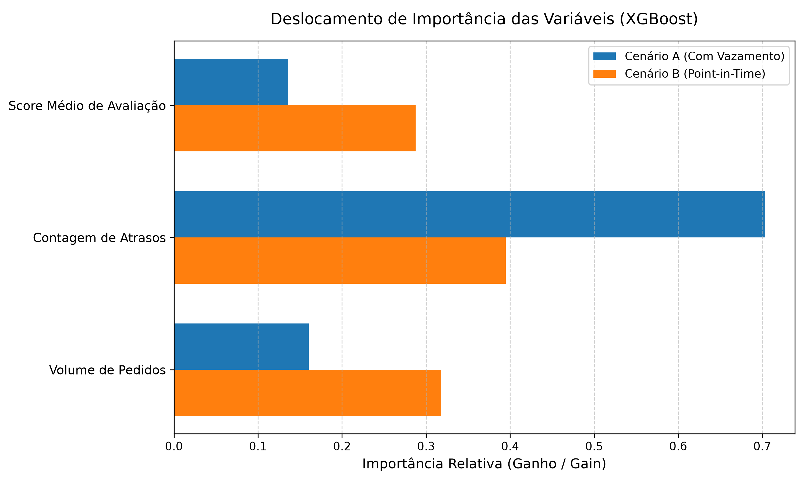
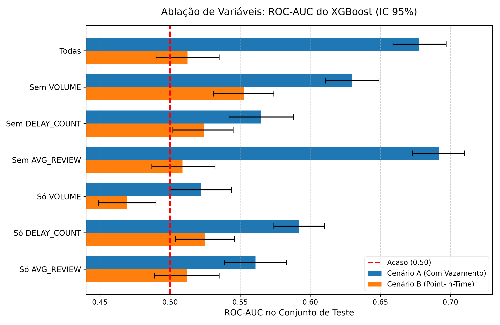
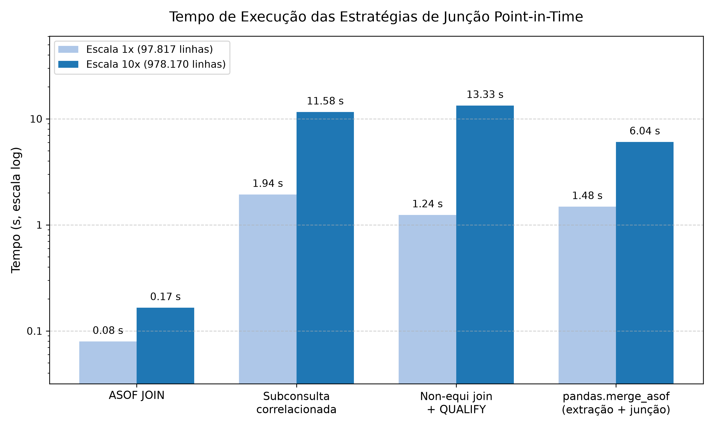

# Arquitetura Lakehouse e Feature Store Temporal: Mitigação de Data Leakage em Pipelines de MLOps

Código-fonte do Trabalho de Conclusão de Curso em Engenharia de Computação (UFRN) de **Poliana Ellen de Araújo**, sob orientação do **Prof. Dr. Carlos Manuel Dias Viegas**.

O projeto implementa uma **Feature Store temporal** sobre um *Lakehouse* no Snowflake, com transformações no dbt e orquestração no Apache Airflow. Ele mede empiricamente o efeito do **vazamento temporal de dados** (*time-travel data leakage*) comparando dois *datasets* construídos a partir das mesmas variáveis:

| Cenário | Construção | O que cada pedido "enxerga" |
|---|---|---|
| **A, com vazamento** | `JOIN` simples com o último estado do vendedor | O histórico **completo** do vendedor, incluindo pedidos futuros e o desfecho do próprio pedido |
| **B, point-in-time** | `ASOF JOIN` em cada linha do tempo da Feature Store | Apenas o que já era **conhecido** no instante da compra |

## Arquitetura



### A Feature Store

Cada variável do vendedor fica em uma **linha do tempo própria**, indexada pelo instante em que a informação passa a existir de fato:

| Variável | Modelo dbt | Conhecida a partir de |
|---|---|---|
| `SELLER_ORDER_VOLUME`: pedidos recebidos | `gold_fs_seller_volume` | compra do pedido |
| `SELLER_DELAY_COUNT`: pedidos entregues com atraso | `gold_fs_seller_delay` | entrega do pedido |
| `SELLER_AVG_REVIEW_SCORE`: nota média | `gold_fs_seller_review` | resposta da avaliação |

Indexar tudo pela data da compra ainda deixaria vazar o atraso de pedidos anteriores que estavam em trânsito: neste *dataset*, isso afetaria 19% dos atrasos contabilizados. O Cenário B aplica um `ASOF JOIN` com condição **estritamente anterior** (`data_do_pedido > feature_timestamp`) em cada linha do tempo.

O histórico é derivado dos próprios eventos com funções de janela cumulativas. Cada versão de estado vale até a próxima, o que equivale a uma dimensão SCD Tipo 2. Por isso a Feature Store pode ser reconstruída de forma determinística a cada `dbt run`.

**Rótulo:** `TARGET_HOUVE_ATRASO = 1` quando o pedido é entregue em um **dia** posterior ao prometido (`order_delivered_at::DATE > order_estimated_delivery_at::DATE`). A data estimada do Olist é sempre 00:00:00; comparar *timestamps* marcaria como atraso as entregas feitas no próprio dia prometido.

## Estrutura do repositório

```
.
├── tcc_feature_store/              # projeto dbt
│   ├── models/01_bronze/           # sources (tabelas RAW_olist_*)
│   ├── models/02_silver/           # limpeza e padronização
│   ├── models/03_gold/             # base de eventos, linhas do tempo e datasets A/B
│   └── macros/                     # generate_schema_name (schemas bronze/silver/gold)
├── airflow-tcc/dags/dag_tcc.py     # DAG de orquestração
├── script_ml.py                    # treino e avaliação (RF, Reg. Logística, XGBoost) + gráficos
├── analise_vazamento.py            # diferença A vs B pedido a pedido + ablação de variáveis
├── bootstrap_pareado.py            # IC pareados (A-B, entre modelos), bootstrap por vendedores, PR-AUC, diagnósticos
├── avaliacao_cruzada.py            # treino em A/B e teste em A/B (mede o training-serving skew)
├── ablacao_pareada.py              # ablação com IC pareados e AUC univariada treino x teste
├── benchmark_joins.py              # ASOF JOIN vs subconsulta correlacionada vs non-equi join vs pandas
├── gerar_graficos_tcc.py           # gráficos de IC 95%, ablação e benchmark
├── verificacao_pos_dbt.sql         # checagens de integridade e de consistência temporal
├── assets/                         # CSVs e PNGs gerados pelos scripts
└── requirements.txt
```

## Como reproduzir

### 1. Pré-requisitos

- Python 3.10+ (desenvolvido no WSL/Ubuntu)
- Conta Snowflake com um *warehouse* (X-Small é suficiente) e permissão para criar o banco `TCC_LAKEHOUSE`
- [Brazilian E-Commerce Public Dataset by Olist](https://www.kaggle.com/datasets/olistbr/brazilian-ecommerce): arquivos `olist_orders_dataset.csv`, `olist_order_items_dataset.csv`, `olist_order_reviews_dataset.csv` e `olist_sellers_dataset.csv` em `dataset_tcc/`

### 2. Ambiente Python

```bash
python -m venv venv_tcc
source venv_tcc/bin/activate
pip install -r requirements.txt

# Airflow precisa do arquivo de restrições oficial
PYV=$(python -c 'import sys; print(f"{sys.version_info.major}.{sys.version_info.minor}")')
pip install "apache-airflow==2.10.2" \
  --constraint "https://raw.githubusercontent.com/apache/airflow/constraints-2.10.2/constraints-${PYV}.txt"
```

### 3. Autenticação no Snowflake (par de chaves RSA)

```bash
openssl genrsa 2048 | openssl pkcs8 -topk8 -inform PEM -out rsa_key.p8 -nocrypt
openssl rsa -in rsa_key.p8 -pubout -out rsa_key.pub
```

Registre a chave pública no seu usuário (`ALTER USER <usuario> SET RSA_PUBLIC_KEY='...';`) e crie um `.env` na raiz:

```dotenv
SNOWFLAKE_USER=...
SNOWFLAKE_ACCOUNT=...
SNOWFLAKE_WAREHOUSE=...
SNOWFLAKE_DATABASE=TCC_LAKEHOUSE
SNOWFLAKE_SCHEMA=GOLD
```

`rsa_key.p8` e `.env` estão no `.gitignore` e **nunca** devem ser versionados.

Para o dbt, configure `~/.dbt/profiles.yml`:

```yaml
tcc_feature_store:
  target: dev
  outputs:
    dev:
      type: snowflake
      account: <conta>
      user: <usuario>
      private_key_path: /caminho/para/rsa_key.p8
      warehouse: <warehouse>
      database: TCC_LAKEHOUSE
      schema: SILVER
      threads: 4
```

### 4. Camada Bronze

Carregue os quatro CSVs no schema `TCC_LAKEHOUSE.BRONZE` com os nomes `RAW_olist_orders_dataset`, `RAW_olist_order_items_dataset`, `RAW_olist_order_reviews_dataset` e `RAW_olist_sellers_dataset`. As colunas de data devem ser `TIMESTAMP_NTZ`. Os nomes têm letras minúsculas; por isso o `sources.yaml` usa `quoting: identifier: true`.

A carga foi feita uma única vez, fora da DAG (ver *Limitações*).

### 5. Execução

**Pelo Airflow:**

```bash
export AIRFLOW_HOME=~/github/tcc-1/airflow-tcc
airflow db migrate
airflow users create --username admin --role Admin --firstname Admin --lastname TCC --email admin@example.com --password <senha>
airflow webserver --port 8080     # terminal 1
airflow scheduler                 # terminal 2
```

Na interface (http://localhost:8080), dispare a DAG **`pipeline_tcc_dbt_xgboost`**:

```
executar_modelos_dbt  ──►  treinar_modelo_xgboost
      (dbt run)       └─►  analisar_vazamento
```

**Ou manualmente:**

```bash
cd tcc_feature_store && dbt run && cd ..
python script_ml.py
python analise_vazamento.py
python bootstrap_pareado.py      # análises estatísticas complementares (fora da DAG)
python avaliacao_cruzada.py      # avaliação cruzada entre cenários (fora da DAG)
python ablacao_pareada.py        # ablação com IC pareados (fora da DAG)
python benchmark_joins.py        # opcional: escalas 1x e 10x, ~5 min em X-Small; requer a tabela legada GOLD_SELLER_FEATURES (ver Limitações)
python gerar_graficos_tcc.py
```

### 6. Verificação

Depois do `dbt run`, execute `verificacao_pos_dbt.sql` no Snowsight. As consultas 4 a 6 são **testes de consistência temporal** do Cenário B: contam quantos pedidos "enxergam" um atraso ainda não entregue, um volume ou uma nota média que não correspondem ao estado do vendedor estritamente antes da compra. **O resultado esperado é 0** nas três. A consulta 7 é o controle positivo (as mesmas consultas aplicadas ao Cenário A devem retornar muitas violações) e a 8 mede quantos registros do Cenário B recebem nota 0 por falta de avaliação.

## Resultados

Validação *out-of-time*: treino nos 80% de pedidos mais antigos e teste nos 20% mais recentes (19.564 registros, 3,44% de atrasos). IC 95% por *bootstrap* com 1.000 reamostragens.

| Modelo | Cenário A, ROC-AUC [IC 95%] | Cenário B, ROC-AUC [IC 95%] |
|---|---|---|
| Random Forest | 0,677 [0,659; 0,695] | 0,511 [0,489; 0,532] |
| Regressão Logística | 0,582 [0,561; 0,602] | 0,494 [0,471; 0,515] |
| **XGBoost** | **0,678** [0,659; 0,697] | **0,512** [0,490; 0,535] |

- **No Cenário A** os modelos parecem úteis: a PR-AUC do XGBoost é 2,75× a linha de base. **No Cenário B** todos são estatisticamente indistinguíveis do acaso, com a PR-AUC praticamente igual à taxa de positivos.
- **Diferença pedido a pedido:** 100% dos registros têm ao menos uma variável diferente entre A e B.
- **Ablação:** a contagem de atrasos é o principal vetor de vazamento. Removê-la reduz em 75% a diferença entre os cenários. Sem vazamento, a melhor combinação de variáveis (atrasos + notas) atinge apenas 0,553.
- **Desempenho do `ASOF JOIN`:** foi de 16 a 81× mais rápido que a subconsulta correlacionada e o *non-equi join* no próprio Snowflake. Com 10× mais dados, o tempo dele apenas dobrou (0,080 s → 0,166 s), enquanto as alternativas cresceram de 6 a 11×.







## Limitações

- **Dataset estático:** o Olist cobre 2016–2018, e o processamento é em lote, disparado manualmente.
- **Ingestão fora da DAG:** a carga da camada Bronze foi feita uma única vez, fora do Airflow.
- **Instantes de disponibilidade:** vêm das datas do próprio *dataset* (entrega e resposta da avaliação). Um sistema real teria ainda atrasos operacionais de registro.
- **Mudança na taxa de atraso:** ela cai de 7,5% no treino para 3,4% no teste. A mudança afeta igualmente os dois cenários.
- **Tabela legada do *benchmark*:** `benchmark_joins.py` lê `TCC_LAKEHOUSE.GOLD.GOLD_SELLER_FEATURES` (97.817 linhas, uma por par pedido–vendedor, de 2.970 vendedores), a versão preliminar da *Feature Store* com uma versão do estado do vendedor por pedido. Nenhum modelo dbt atual a gera: ela foi criada em 12/10/2026 por uma versão intermediária do modelo `gold_seller_features`, removido do repositório no commit `a470729` (o arquivo no histórico, de 06/09/2026, não é idêntico à versão que gerou a tabela). Os resultados do *benchmark* estão salvos em `assets/benchmark_joins_*.csv`, mas o *script* só pode ser reexecutado enquanto essa tabela existir no Snowflake. Não a apague e não crie um modelo com esse nome sem refazer o *benchmark*, pois o `dbt run` a sobrescreveria.

## Tecnologias

Snowflake · dbt (dbt-snowflake 1.12) · Apache Airflow 2.10.2 · Python · scikit-learn · XGBoost · pandas · matplotlib
